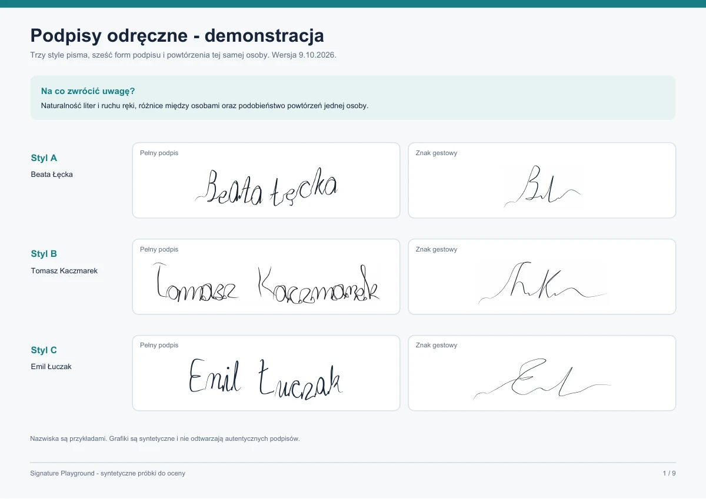

# Signature Playground

Lokalny generator **fikcyjnych podpisów odręcznych** w formacie SVG. Dla jednej osoby zachowuje stały charakter pisma, a kolejne próbki różnią się drobnymi ruchami. Automatycznie przypisuje jeden z trzech stylów A/B/C. Obsługuje polskie litery. Nie wymaga bibliotek do działania i nie odtwarza podpisu rzeczywistej osoby.



## Szybki start

Wymagany jest Python 3.10 lub nowszy. Otwórz folder projektu w edytorze, a w jego terminalu wklej:

```powershell
python run.py
```

Jeśli na Windows polecenie `python` nie działa, użyj `py run.py`. Skrypt zapisze pliki SVG w folderze `output` i otworzy lokalną galerię `output/index.html`. W [run.py](run.py) zmień listę `NAMES`, liczbę `SAMPLES_PER_FORM` albo listę `FORMS`, aby wygenerować własny zestaw.

## Użycie jako modułu

W terminalu otwartym **w folderze projektu** zainstaluj lokalnie:

```powershell
python -m pip install .
```

Potem w swoim pliku Python:

```python
from pathlib import Path
from signature_playground import render, writer_style

name = "Anna Nowak"
svg = render(name, sample=0, variant=0, plan="full")
Path("podpis.svg").write_text(svg, encoding="utf-8")
print(writer_style(name))  # A, B albo C
```

`render()` zwraca tekst SVG. Ten sam `name`, `sample`, `variant` i `plan` dają taki sam wynik. Zwiększ `sample`, aby uzyskać kolejne wykonanie podpisu tej samej osoby. Zmień `variant`, aby otrzymać inny powtarzalny zestaw.

`plan="auto"` wybiera formę na podstawie imienia i nazwiska. Dostępne formy:

| Plan | Wynik |
| --- | --- |
| `full` | Imię i nazwisko |
| `surname` | Samo nazwisko |
| `initial_surname` | Inicjał i nazwisko |
| `monogram` | Monogram |
| `personal_short` | Krótki podpis |
| `gesture` | Zamaszysty znak oparty na literach |

Formy są dostępne również jako `signature_playground.PLANS`. Wszystkie trzy style są wybierane automatycznie i pozostają stałe dla tego samego imienia.

## Sprawdzenie i cofnięcie

Uruchom ponownie `python run.py` w folderze projektu. Jeśli pojawi się komunikat `Saved ... SVG files`, a `output/index.html` pokazuje galerię, generator działa. Aby usunąć wygenerowane dane, zamknij galerię i usuń folder `output`; kod pozostanie bez zmian. Aby cofnąć lokalną instalację modułu, użyj `python -m pip uninstall signature-playground-svg`.

Kod jest udostępniony na licencji [MIT](LICENSE). Podpisy są syntetyczną grafiką do demonstracji i testowania.
